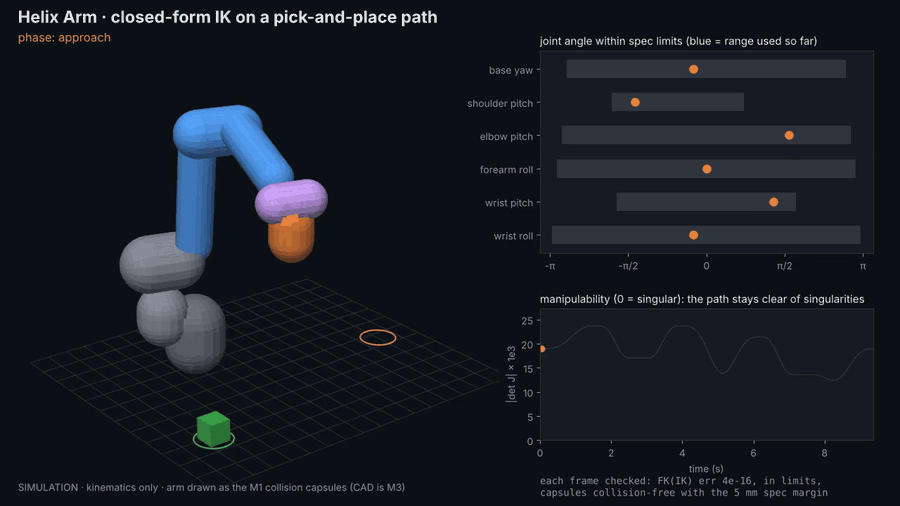
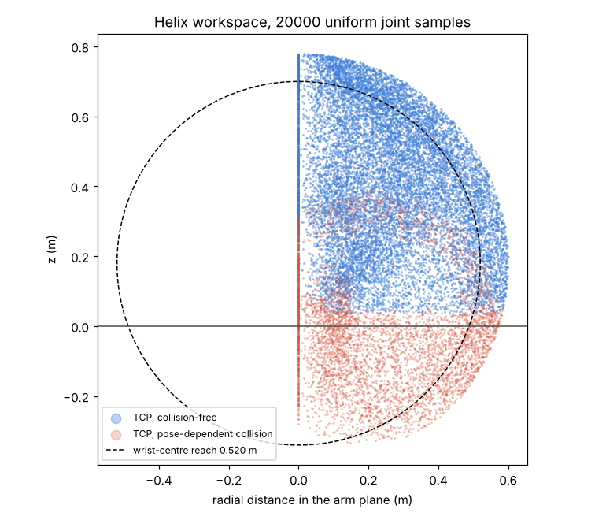
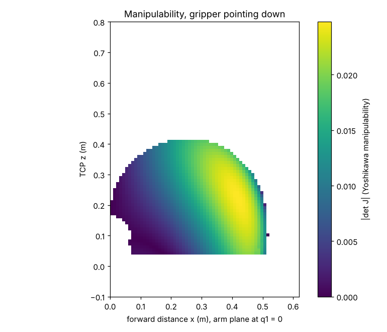

# Helix Arm

A desktop 6-axis robot arm (6 joints + gripper, 1.0 kg at 600 mm reach) designed from the actuator up and
proven entirely in simulation: own BLDC + cycloidal/planetary joint modules, joint-driver and hub PCBs,
FOC firmware, rigid-body dynamics and a firmware-in-the-loop MuJoCo twin. Its hub speaks the
[vla-arm](https://github.com/Ashtonantony28/vla-arm) protocol so vla-arm's policies can run on it.

The plan is in [docs/PLAN.md](docs/PLAN.md). Nothing has been built or measured on hardware.

## Demo



The M1 kinematics drive a tool-down pick-and-place path (`python scripts/ik_demo.py`, [MP4](docs/media/ik-demo.mp4)).
At every frame the closed-form IK picks the in-limit branch nearest the previous one. Before the frame is
drawn, the script checks that forward kinematics reproduces the target pose (error < 1e-9), that every joint
is inside its spec limit, and that the capsule envelope is collision-free with the 5 mm margin. The arm is
drawn as its M1 collision capsules, because CAD comes in M3. This is kinematics only, with no dynamics or
hardware.

| Reachable workspace (arm plane) | Manipulability, gripper pointing down |
|---|---|
|  |  |

## Status

| | |
|---|---|
| Spec | `spec/arm.yaml` v1.0, frozen in M1 ([ADR 0003](docs/adr/0003-elbow-offset-envelope-and-m1-freeze.md)) |
| Kinematics | [docs/kinematics/kinematics.md](docs/kinematics/kinematics.md): DH table, derived joint limits, workspace and manipulability maps |
| Milestones | [STATUS.md](STATUS.md) |

```
pip install -e ".[test]"
pytest -q                                  # everything (~45 s)
python -m helix.kinematics.workspace       # regenerate docs/kinematics/
python -m helix.kinematics.limits          # joint-limit derivation from the collision envelope
python -m helix.kinematics.golden          # regenerate the golden IK fixture (reviewed change)
```
