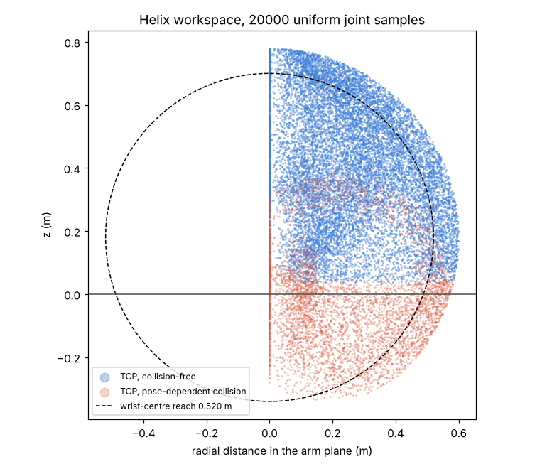
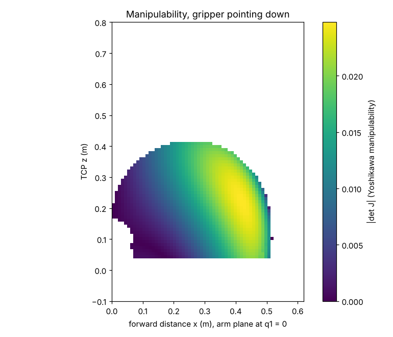

# Helix kinematics (M1, spec v1.0)

Generated by `python -m helix.kinematics.workspace`; do not edit. Everything is computed from
`spec/arm.yaml`; nothing is measured (ADR 0002).

## Modified DH parameters (derived view of the spec, ADR 0001)

| i | joint | alpha_{i-1} (rad) | a_{i-1} (m) | theta offset (rad) | d_i (m) |
|---|---|---|---|---|---|
| 1 | base_yaw | +0.000000 | +0.0000 | +0.000000 | +0.0000 |
| 2 | shoulder_pitch | +1.570796 | +0.0000 | -3.141593 | -0.0000 |
| 3 | elbow_pitch | -0.000000 | +0.2600 | +1.570796 | +0.0800 |
| 4 | forearm_roll | +1.570796 | +0.0000 | -3.141593 | +0.2600 |
| 5 | wrist_pitch | +1.570796 | +0.0000 | -3.141593 | -0.0000 |
| 6 | wrist_roll | +1.570796 | +0.0000 | -0.000000 | -0.0000 |

Arm-plane geometry used by the closed-form IK: shoulder height 0.180 m, lateral elbow offset 0.080 m (ADR 0003), upper arm 0.260 m, forearm to wrist centre 0.260 m, wrist centre to TCP 0.080 m.

## Joint limits from the collision envelope

| joint | direction | first contact (rad) | pair | derived limit (rad) | spec limit (rad) |
|---|---|---|---|---|---|
| shoulder_pitch | + | +0.776 | base_column/upper_arm | +0.75 | +0.75 |
| shoulder_pitch | - | free | - | -3.14 | -1.90 |
| elbow_pitch | + | +2.949 | upper_arm/wrist_module | +2.90 | +2.90 |
| elbow_pitch | - | -2.949 | upper_arm/wrist_module | -2.90 | -2.90 |
| wrist_pitch | + | +1.824 | forearm/gripper | +1.80 | +1.80 |
| wrist_pitch | - | -1.824 | forearm/gripper | -1.80 | -1.80 |

`free` means no contact over the half turn; that limit is kept from the plan (no need to reach further back).

## Workspace

- 20000 uniform samples inside the joint limits.
- Wrist-centre distance from the shoulder axis: 0.063 .. 0.520 m (analytic 0.520 m max, 0.063 m min at the elbow limit).
- Pose-dependent self-collision in 5.9 % of samples and table contact in 23.9 %; these are left to the host-side collision check, not to joint limits.
- Gripper pointing down, 50 mm above the table: reachable (in limits, collision-free) from 0.070 to 0.510 m forward.

Singularities (|det J| = 0), all checked in `tests/kinematics/test_singularities.py`: wrist (q5 = 0, J4 and
J6 aligned), elbow (q3 = 0 or pi, arm stretched), shoulder (wrist centre on the cylinder of radius D around
the J1 axis).
